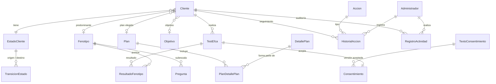

# Modelo de datos — Portal "ReConectá con Vos"

**Versión:** 5.0
**Reemplaza a:** versión 4.0 de este documento.
**Fuentes:** prototipo de la página principal (landing: planes, prestaciones, precios, FAQ), prototipo del test EFCA (preguntas, puntajes, consentimiento, datos de contacto) y prototipo `Administracion_WN.html` (Portal del Equipo).

**Qué cambió respecto a la V4.0** (detalle en 6.1):
- **Ya no se guardan las respuestas individuales del test.** Se elimina la tabla `RespuestaTest`; de cada test solo se conserva el **resultado** (`TestEfca` + `ResultadoFenotipo`: puntaje, nivel y fenotipo predominante por subescala). Las respuestas se usan solo en el momento para calcular y luego se descartan.
- `TestEfca` se simplifica: como no hay guardado parcial, se elimina `Estado` y las fechas `IniciadoEn` / `CompletadoEn` pasan a un único `RealizadoEn`.
- `Pregunta` se mantiene como catálogo (la aplicación la necesita para mostrar y puntuar el test), pero ya no tiene respuestas asociadas.
- **`Cliente.Edad` vuelve a `FechaNacimiento`** (date): la edad se calcula a partir de la fecha y no se desactualiza. El test debe pedir fecha de nacimiento en lugar de edad.
- **Se elimina la tabla `Pago`.** El pago se registra solo con `Cliente.PagoRecibido` y `Cliente.FechaPago`, que pasan a ser la única fuente de verdad.
- **`Cliente.Email` y `Cliente.Telefono` pasan a ser obligatorios** en todas las altas (test, elección de plan y Portal). `Email` es único.
- Se actualizan las reglas 4.5 y 4.6 y se agrega la nota 22 con las consecuencias de esta decisión.

**Cambios de la V4.0 respecto de la V3.0** (se mantienen; detalle en 6.2):
- **Plan:** se agregan `Codigo`, `Subtitulo`, `LeyendaPeriodo`, `DuracionSemanas` y `EsDestacado` según las tarjetas de precios de la landing; se cargan las 14 prestaciones (`DetallePlan`) y qué plan incluye cada una.
- **Test EFCA:** se cargan las 16 preguntas, los umbrales y los textos de resultado de cada fenotipo; `TestEfca` distingue test **inicial** y **final** (`Momento`).
- **Cliente:** `Objetivo` pasa a catálogo (`ObjetivoId`) y se agrega `Origen` (test online o alta manual).
- **Consentimiento:** el texto legal pasa a una tabla versionada (`TextoConsentimiento`).
- **Administrador:** se separan `NombreCompleto`, `Titulo` y `Matricula`.
- Se agregan las reglas de cálculo del test (sección 4.5) y el alta desde el test (4.6), y se registran las inconsistencias detectadas entre prototipos (notas 11 a 21).

**Cambios de la V3.0 respecto de la V2.0** (se mantienen; detalle en 6.3):
- Se completan los campos del Cliente que usa el Portal: fecha y tipo de acción, pago, observaciones.
- `HistorialActividad` de la V2.0 se separa en dos tablas: **`HistorialAccion`** (acciones de seguimiento: mails, consultas, encuentros; programadas y realizadas) y **`RegistroActividad`** (auditoría de cambios hecha por el equipo).
- Se agrega **`TransicionEstado`** (flujo de estados y evento que dispara cada cambio).
- Se completan los catálogos `Plan`, `Accion`, `EstadoCliente`, `Fenotipo` y `Administrador` con los valores reales del prototipo.
- Se completa el bloque "Preguntas" (test EFCA), que en la V2.0 figuraba como pendiente: `Pregunta`, `TestEfca`, `Consentimiento`, `ResultadoFenotipo` (en la V5.0 se eliminó `RespuestaTest`).
- Se agrega `Pago` para el registro manual de pagos (eliminada en la V5.0).
- Se unifican las convenciones: tablas en español, singular, PascalCase; PK `Id`; FK `<Tabla>Id`; booleano de vigencia `EstaActivo`.

**Alcance de este modelo:** registración de clientes (leads, inscriptos, activos, pausados, finalizados), seguimiento de acciones del equipo, estado y plan del cliente, ejecución y resultado del test EFCA (con consentimiento), registro de pago manual y auditoría de cambios.

**Fuera de alcance en esta versión:** integración real con pasarela de pago, envío automatizado de emails (el sistema solo registra que la acción se realizó), historial clínico, múltiples planes por cliente a lo largo del tiempo.

---

# 1. Diagrama de relaciones

| Relación | Cardinalidad | Clave |
|---|---|---|
| Cliente → EstadoCliente | N:1 | `Cliente.EstadoId` |
| Cliente → Fenotipo | N:1 (opcional) | `Cliente.FenotipoId` |
| Cliente → Plan | N:1 (opcional) | `Cliente.PlanId` — **un único plan por cliente** |
| Cliente → Objetivo | N:1 (opcional) | `Cliente.ObjetivoId` |
| Plan ↔ DetallePlan | N:M, vía `PlanDetallePlan` (un Plan tiene "n" Detalles) | `PlanDetallePlan.PlanId`, `PlanDetallePlan.DetallePlanId` |
| Cliente → HistorialAccion | 1:N | `HistorialAccion.ClienteId` |
| Accion → HistorialAccion | 1:N | `HistorialAccion.AccionId` |
| Administrador → HistorialAccion | 1:N | `HistorialAccion.AdministradorId` |
| Cliente → RegistroActividad | 1:N | `RegistroActividad.ClienteId` |
| Administrador → RegistroActividad | 1:N (nulo si lo generó el sistema) | `RegistroActividad.AdministradorId` |
| EstadoCliente → TransicionEstado | 1:N (origen) y 1:N (destino) | `EstadoOrigenId`, `EstadoDestinoId` |
| Cliente → TestEfca | 1:N | `TestEfca.ClienteId` |
| TestEfca → Consentimiento | 1:1 | `Consentimiento.TestEfcaId` (único) |
| TextoConsentimiento → Consentimiento | 1:N | `Consentimiento.TextoConsentimientoId` |
| TestEfca → ResultadoFenotipo | 1:N (5 filas por test) | `ResultadoFenotipo.TestEfcaId` |
| Fenotipo → ResultadoFenotipo / Pregunta | 1:N | `FenotipoId` |

---

# 2. Entidades

## 2.1 Cliente

Representa a una persona en cualquier punto de su recorrido: desde que hace el test EFCA o completa el formulario de inscripción (lead) hasta que es clienta activa, pausada o finalizada del programa. Es la misma entidad que el Portal del Equipo muestra en la grilla "Clientes"; no hay una tabla separada para el backoffice.

| Campo | Tipo | Obligatorio | Notas |
|---|---|---|---|
| `Id` | PK | SÍ | |
| `Nombre` | varchar(150) | SÍ | "Nombre y apellido" |
| `Email` | varchar(150) | SÍ | Único. Se valida el formato. Obligatorio en todas las altas: test, elección de plan y Portal (ver nota 1) |
| `Telefono` | varchar(30) | SÍ | "WhatsApp / Teléfono". Obligatorio en todas las altas. Texto libre (ej. `3428999567`, `+54 9 11 1234-5678`); el formato exacto a validar queda por definir (ver nota 1) |
| `FechaNacimiento` | date | NO | Dato del test EFCA. La edad se calcula a partir de esta fecha. Si se informa, debe corresponder a una persona de 18 años o más |
| `ObjetivoId` | FK | NO | → `Objetivo`. "¿Cuál es tu objetivo principal?" del test EFCA |
| `FenotipoId` | FK | NO | → `Fenotipo`. Nulo = "Sin evaluar". Se completa con el resultado del test o a mano desde el Portal |
| `EstadoId` | FK | SÍ | → `EstadoCliente`. Default: `Inscripto` |
| `PlanId` | FK | NO | → `Plan`. Nulo = "Sin definir". **Un solo plan por cliente** |
| `FechaInscripcion` | date | SÍ | Default: fecha del día en que se crea el registro |
| `PagoRecibido` | boolean | SÍ | Default `false`. Habilita el paso a `Activo` (ver 4.2). Es el único registro del pago (ver nota 3) |
| `FechaPago` | date | NO | Obligatoria solo si `PagoRecibido = true`; si no se informa, se usa la fecha del día. Se limpia si se desmarca el pago |
| `Observacion` | text | NO | Campo "Notas / Observaciones" del modal de edición |
| `Origen` | varchar(20) | SÍ | `test_efca` (alta desde el test online) / `manual` (alta desde el Portal, o desde la web al elegir plan sin haber hecho el test). Default `manual` |
| `CreadoEn` | timestamp | SÍ | Default now() |
| `ActualizadoEn` | timestamp | NO | |

**Datos que el Portal muestra pero NO se guardan en esta tabla (se derivan):**

| Dato en la grilla / modal | Origen |
|---|---|
| Última acción (tipo + fecha) | `HistorialAccion` con `FechaRealizada` más reciente del cliente |
| Próxima acción (tipo) y Fecha Programada | La única fila de `HistorialAccion` del cliente con `FechaRealizada` nula (ver 4.3) |
| Estado visible: *Pago pendiente / Pago realizado / Programa en proceso / Programa finalizado* | `PagoRecibido` + `EstadoCliente` (tabla de la sección 4.1) |
| KPIs (Total, Programa activo, Inscriptos, Pago pendiente) | Conteos sobre `Cliente` |

---

## 2.2 Plan

Catálogo de planes comerciales. Plan elegido por el cliente en `Cliente.PlanId`.

| Campo | Tipo | Obligatorio | Notas |
|---|---|---|---|
| `Id` | PK | SÍ | |
| `Nombre` | varchar(60) | SÍ | `Esencial` / `Completo` / `Premium` (el nombre anterior "VIP" fue reemplazado por "Premium") |
| `Codigo` | varchar(20) | SÍ | Único. `esencial` / `completo` / `premium`. Es el parámetro `plan` de `checkout.html?plan=` |
| `Subtitulo` | varchar(80) | NO | `Solo Materiales` / `Con Acompañamiento` / `Experiencia Grupal` |
| `LeyendaPeriodo` | varchar(150) | NO | Texto bajo el precio, ej. "pago único · 4 semanas de acompañamiento" |
| `DuracionSemanas` | int | NO | 4 en los tres planes |
| `EsDestacado` | boolean | SÍ | `true` para el plan con la insignia "Más elegido" (Completo). Default `false` |
| `Precio` | decimal(10,2) | NO | Parametrizable, no hardcodeado. La landing muestra el placeholder `$ XX.XXX` (precio a definir) |
| `Moneda` | varchar(10) | NO | ej. `ARS` |
| `Orden` | int | NO | Orden de visualización en los selectores |
| `EstaActivo` | boolean | SÍ | `true` = el plan sigue a la venta. Permite ocultar planes sin borrarlos |

## 2.3 DetallePlan

Catálogo de prestaciones o ítems que pueden formar parte de un plan (ej. "Lista de compras saludable", "Técnicas de Mindful Eating", "Certificado de participación"; ver la lista completa en la sección 3).

| Campo | Tipo | Obligatorio | Notas |
|---|---|---|---|
| `Id` | PK | SÍ | |
| `Nombre` | varchar(100) | SÍ | |
| `Descripcion` | text | NO | |
| `EstaActivo` | boolean | SÍ | Permite ocultar ítems sin borrarlos |

## 2.4 PlanDetallePlan

Tabla intermedia: define qué detalles incluye cada plan. Un Plan tiene "n" Detalles y un Detalle puede repetirse en varios Planes.

| Campo | Tipo | Obligatorio | Notas |
|---|---|---|---|
| `Id` | PK | SÍ | |
| `PlanId` | FK | SÍ | → `Plan` |
| `DetallePlanId` | FK | SÍ | → `DetallePlan` |
| `Orden` | int | NO | Orden de presentación dentro del plan |
| `EstaActivo` | boolean | SÍ | Permite quitar un detalle de un plan sin borrar el vínculo |

Restricción: único (`PlanId`, `DetallePlanId`).

---

## 2.5 EstadoCliente

Catálogo de estados del programa.

| Campo | Tipo | Obligatorio | Notas |
|---|---|---|---|
| `Id` | PK | SÍ | |
| `Descripcion` | varchar(60) | SÍ | `Inscripto` / `Activo` / `Pausado` / `Finalizado` |
| `Orden` | int | NO | |
| `EstaActivo` | boolean | SÍ | |

> El estado `Prospecto` de versiones anteriores fue renombrado a `Inscripto`.

## 2.6 TransicionEstado

Define el flujo esperado entre estados y el evento de negocio que dispara cada cambio. El Portal la usa para validar y para mostrar el "Flujo de estados del programa".

| Campo | Tipo | Obligatorio | Notas |
|---|---|---|---|
| `Id` | PK | SÍ | |
| `EstadoOrigenId` | FK | SÍ | → `EstadoCliente` |
| `EstadoDestinoId` | FK | SÍ | → `EstadoCliente` |
| `Evento` | varchar(150) | SÍ | Evento que provoca el cambio |
| `RequiereConfirmacion` | boolean | SÍ | `true` para las excepciones (el Portal pide confirmar) |
| `EstaActivo` | boolean | SÍ | |

Restricción: único (`EstadoOrigenId`, `EstadoDestinoId`).

## 2.7 Fenotipo

Catálogo de fenotipos del test EFCA (subescalas) y textos del resultado.

| Campo | Tipo | Obligatorio | Notas |
|---|---|---|---|
| `Id` | PK | SÍ | |
| `Codigo` | varchar(30) | SÍ | Único. `desorganizado`, `hedonico`, `compulsivo`, `emocional`, `hiperfagico` |
| `Descripcion` | varchar(60) | SÍ | Nombre corto usado en el Portal: `Desorganización`, `Hedónico / Sensorial`, `Compulsivo`, `Emocional / Picoteador`, `Hiperfágico` |
| `NombreResultado` | varchar(60) | SÍ | Nombre mostrado en el resultado del test: `Comedor Desorganizado`, `Comedor Hedónico`, `Comedor Compulsivo`, `Emocional / Picoteador`, `Hiperfágico` (ver nota 11) |
| `Icono` | varchar(10) | NO | Emoji del resultado: ⏳ 👁️ ⚡ 🎭 🍔 |
| `UmbralBajo` | int | NO | Límite superior del nivel bajo: puntaje ≤ `UmbralBajo` ⇒ `bajo` |
| `UmbralMedio` | int | NO | Límite superior del nivel medio: puntaje ≤ `UmbralMedio` ⇒ `medio`; mayor ⇒ `alto` |
| `PuntajeMax` | int | NO | Puntaje máximo posible de la subescala |
| `TextoBajo` | text | NO | Texto mostrado en el resultado, nivel bajo |
| `TextoMedio` | text | NO | Ídem, nivel medio |
| `TextoAlto` | text | NO | Ídem, nivel alto |
| `EstaActivo` | boolean | SÍ | |

## 2.8 Accion

Catálogo de acciones de seguimiento que el equipo programa y realiza con cada cliente.

| Campo | Tipo | Obligatorio | Notas |
|---|---|---|---|
| `Id` | PK | SÍ | |
| `Codigo` | varchar(40) | SÍ | Único. Ej. `mail_bienvenida` (clave usada por el prototipo) |
| `Descripcion` | varchar(80) | SÍ | Texto visible |
| `Orden` | int | NO | |
| `EstaActivo` | boolean | SÍ | |

---

## 2.9 HistorialAccion

Reemplaza a `HistorialActividad` de la V2.0 (que tenía `FechaProgamada` y `Realizada`). Cada fila es una acción de seguimiento de un cliente, **programada y/o realizada**. Alimenta las columnas *Última acción*, *Próxima acción* y *Fecha Programada* de la grilla, y la solapa **Historial** del detalle.

| Campo | Tipo | Obligatorio | Notas |
|---|---|---|---|
| `Id` | PK | SÍ | |
| `ClienteId` | FK | SÍ | → `Cliente` |
| `AccionId` | FK | SÍ | → `Accion` |
| `FechaProgramada` | date | NO | Fecha prevista. Nula si la acción se registró directamente como ya realizada |
| `FechaRealizada` | date | NO | Nula = acción **pendiente** (próxima acción). Con valor = acción **realizada** (reemplaza al booleano `Realizada` de la V2.0) |
| `AdministradorId` | FK | NO | → `Administrador`. Quién la registró / marcó como realizada |
| `CreadoEn` | timestamp | SÍ | Default now() |

Reglas:
- Al menos una de `FechaProgramada` o `FechaRealizada` debe tener valor.
- Un cliente tiene como máximo **una** acción pendiente (`FechaRealizada` nula). Índice único parcial sobre `ClienteId` donde `FechaRealizada IS NULL`.
- "Marcar como realizada" completa `FechaRealizada` (default: fecha del día) y deja libre la próxima acción para programar otra.
- Si la acción se cargó a mano como "Última acción" y no existía en el historial, se inserta con `FechaRealizada` y sin `FechaProgramada`.

## 2.10 RegistroActividad

Registro auditable de los cambios hechos por el equipo (la lista "Actividad reciente" de la solapa Historial).

| Campo | Tipo | Obligatorio | Notas |
|---|---|---|---|
| `Id` | PK | SÍ | |
| `ClienteId` | FK | SÍ | → `Cliente` |
| `AdministradorId` | FK | NO | → `Administrador`. Nulo si lo generó el sistema |
| `Descripcion` | text | SÍ | Texto legible, ej. `Marcó: Pago recibido (15/09/2026)`, `Cambió estado: Inscripto → Activo (Pago confirmado)`, `Plan: Sin definir → Premium`, `Acción realizada: Mail de Bienvenida (15/09/2026)`, `Persona agregada (estado inicial: Inscripto)` |
| `CreadoEn` | timestamp | SÍ | Default now() |

Solo se inserta (no se edita ni se borra). El prototipo recorta a las últimas 15 entradas; en producción se conservan todas y la UI muestra las recientes.

## 2.11 Administrador

Integrantes del equipo que operan el Portal.

| Campo | Tipo | Obligatorio | Notas |
|---|---|---|---|
| `Id` | PK | SÍ | |
| `Nombre` | varchar(150) | SÍ | `Sofia`, `Marilina` |
| `NombreCompleto` | varchar(150) | NO | `Lic. Ana Sofía Alurralde`, `Lic. Marilina Borras` (como figuran en la landing y en las firmas del consentimiento) |
| `Titulo` | varchar(100) | NO | `Licenciada en Nutrición` |
| `Matricula` | varchar(30) | NO | `MP 1440/2`, `MP 1512/2` |
| `Email` | varchar(150) | SÍ | Único |
| `EstaActivo` | boolean | SÍ | Si sigue teniendo acceso al panel |

---

## 2.12 Pregunta

Preguntas del test EFCA (16). Catálogo que usa la aplicación para mostrar y puntuar el test; **no** tiene respuestas asociadas.

| Campo | Tipo | Obligatorio | Notas |
|---|---|---|---|
| `Id` | PK | SÍ | 1 a 16 |
| `Texto` | text | SÍ | |
| `FenotipoId` | FK | SÍ | → `Fenotipo` (subescala a la que pertenece) |
| `Invertida` | boolean | SÍ | `true` solo para la pregunta 9 |
| `Orden` | int | SÍ | |
| `EstaActivo` | boolean | SÍ | Permite dar de baja o reemplazar preguntas del test (las respuestas de cada persona no se guardan) |

## 2.13 TestEfca

Cada vez que una persona completa el test. **Solo se guarda el resultado**: las respuestas individuales no se conservan (ver nota 22). Solo se crea al completar y calcular, por lo que no existe un test "en progreso".

| Campo | Tipo | Obligatorio | Notas |
|---|---|---|---|
| `Id` | PK | SÍ | |
| `ClienteId` | FK | SÍ | → `Cliente` |
| `Momento` | varchar(10) | SÍ | `inicial` / `final`. La landing promete "test inicial y final de hábitos"; el prototipo solo implementa el inicial. Default `inicial` |
| `FenotipoPredominanteId` | FK | SÍ | → `Fenotipo`. Redundante con `ResultadoFenotipo.EsPredominante`, pero útil para consultas |
| `NivelPredominante` | varchar(10) | SÍ | `bajo` / `medio` / `alto` |
| `RealizadoEn` | timestamp | SÍ | Fecha y hora en que se completó el test y se calculó el resultado |

## 2.14 Consentimiento

| Campo | Tipo | Obligatorio | Notas |
|---|---|---|---|
| `Id` | PK | SÍ | |
| `TestEfcaId` | FK | SÍ | → `TestEfca`. Único (1 a 1) |
| `TextoConsentimientoId` | FK | SÍ | → `TextoConsentimiento` (versión del texto legal aceptado). Reemplaza a `VersionTexto` |
| `Aceptado` | boolean | SÍ | Debe ser `true` para avanzar (el botón "Ver mi fenotipo" queda deshabilitado hasta marcarlo). Una sola casilla cubre: lectura, mayoría de edad, persona adulta sana, participación voluntaria y autorización de uso de datos |
| `AceptadoEn` | timestamp | SÍ | |
| `IpOrigen` | varchar(45) | NO | Para auditoría |

## 2.15 ResultadoFenotipo

| Campo | Tipo | Obligatorio | Notas |
|---|---|---|---|
| `Id` | PK | SÍ | |
| `TestEfcaId` | FK | SÍ | → `TestEfca` |
| `FenotipoId` | FK | SÍ | → `Fenotipo` |
| `Puntaje` | int | SÍ | |
| `Nivel` | varchar(10) | SÍ | `bajo` / `medio` / `alto` |
| `EsPredominante` | boolean | SÍ | `true` solo para el fenotipo ganador del test |

Es el **resultado completo** del test de la persona: 5 filas por test, una por fenotipo.

Restricción: único (`TestEfcaId`, `FenotipoId`).

## 2.16 Objetivo

Opciones de "¿Cuál es tu objetivo principal?" del test.

| Campo | Tipo | Obligatorio | Notas |
|---|---|---|---|
| `Id` | PK | SÍ | |
| `Codigo` | varchar(30) | SÍ | Único |
| `Descripcion` | varchar(100) | SÍ | Texto visible |
| `Orden` | int | NO | |
| `EstaActivo` | boolean | SÍ | |

## 2.17 TextoConsentimiento

Versiones del texto del Consentimiento Informado ("Programa Virtual de Alimentación Consciente"), para saber exactamente qué texto aceptó cada persona.

| Campo | Tipo | Obligatorio | Notas |
|---|---|---|---|
| `Id` | PK | SÍ | |
| `Version` | varchar(20) | SÍ | Único. Ej. `1.0` |
| `Titulo` | varchar(150) | SÍ | |
| `Contenido` | text | SÍ | Los 5 bloques: Objetivo, Modalidad, Alcances y limitaciones, Confidencialidad y protección de datos (Ley 25.326), Riesgos y beneficios, más el texto de la casilla de aceptación |
| `VigenteDesde` | date | SÍ | |
| `EstaActivo` | boolean | SÍ | Una sola versión activa a la vez |

---

# 3. Datos iniciales de los catálogos

**EstadoCliente:** Inscripto, Activo, Pausado, Finalizado.

**Plan** (landing):

| Nombre | Codigo | Subtitulo | LeyendaPeriodo | EsDestacado |
|---|---|---|---|---|
| Esencial | `esencial` | Solo Materiales | pago único · acceso de por vida al material | No |
| Completo | `completo` | Con Acompañamiento | pago único · 4 semanas de acompañamiento | Sí ("Más elegido") |
| Premium | `premium` | Experiencia Grupal | pago único · máximo acompañamiento y experiencia grupal virtual | No |

`Precio` pendiente (`XX.XXX` en el prototipo). `DuracionSemanas` = 4.

**DetallePlan y PlanDetallePlan** (✓ = el plan lo incluye):

| # | DetallePlan | Esencial | Completo | Premium |
|---|---|---|---|---|
| 1 | Test EFCA + identificación de fenotipo | ✓ | ✓ | ✓ |
| 2 | Programa de reeducación alimentaria (4 semanas) por mail | ✓ | ✓ | ✓ |
| 3 | Menús y plan de 15 días personalizado | ✓ | ✓ | ✓ |
| 4 | Lista de compras saludable | ✓ | ✓ | ✓ |
| 5 | Escalas y registros en PDF | ✓ | ✓ | ✓ |
| 6 | Técnicas de Mindful Eating | ✓ | ✓ | ✓ |
| 7 | Test inicial y final de hábitos | ✓ | ✓ | ✓ |
| 8 | Consultas por mail semana a semana durante las 4 semanas | | ✓ | ✓ |
| 9 | Adaptaciones del plan según tu fenotipo | | ✓ | ✓ |
| 10 | Informe y devolución de cierre personalizado | | ✓ | ✓ |
| 11 | Consultas por mail personalizadas durante las 4 semanas | | | ✓ |
| 12 | Plan alimentario adaptado a tu rutina | | | ✓ |
| 13 | Experiencia grupal virtual: 1 encuentro con los profesionales y la comunidad | | | ✓ |
| 14 | Certificado de participación | | | ✓ |

Las frases "Todo lo del plan Esencial / Completo" de la landing se materializan repitiendo las filas en `PlanDetallePlan`; el modelo no tiene herencia entre planes. Las líneas tachadas del plan Esencial (seguimiento con las licenciadas, grupo de WhatsApp, informe de cierre) no se modelan: se deducen por ausencia (ver nota 19).

**Fenotipo** (umbrales y textos del test):

| Codigo | Descripcion (Portal) | NombreResultado (test) | UmbralBajo | UmbralMedio | PuntajeMax |
|---|---|---|---|---|---|
| `desorganizado` | Desorganización | Comedor Desorganizado | 4 | 7 | 15 |
| `hedonico` | Hedónico / Sensorial | Comedor Hedónico | 11 | 15 | 20 |
| `compulsivo` | Compulsivo | Comedor Compulsivo | 3 | 7 | 10 |
| `emocional` | Emocional / Picoteador | Emocional / Picoteador | 8 | 13 | 20 |
| `hiperfagico` | Hiperfágico | Hiperfágico | 5 | 9 | 15 |

Los textos `TextoBajo`, `TextoMedio` y `TextoAlto` de cada fenotipo son los de la constante `FENOTIPO_INFO` del test EFCA y se cargan tal cual.

**Accion** (12, en este orden):

| Orden | Codigo | Descripcion |
|---|---|---|
| 1 | `mail_bienvenida` | Mail de Bienvenida |
| 2 | `mail_programa` | Mail programa completo |
| 3 | `mail_menu` | Mail con Menu |
| 4 | `consulta_recibida` | Consulta Recibida |
| 5 | `mail_respuesta` | Mail de Respuesta a Consulta |
| 6 | `mail_semana1` | Mail Semana 1 |
| 7 | `mail_semana2` | Mail Semana 2 |
| 8 | `mail_semana3` | Mail Semana 3 |
| 9 | `mail_semana4` | Mail Semana 4 |
| 10 | `informe_personalizado` | Informe Personalizado |
| 11 | `encuentro_agendado` | Encuentro Agendado |
| 12 | `mail_certificado` | Mail Certificado Participación |

**TransicionEstado:**

| Origen | Destino | Evento | RequiereConfirmacion |
|---|---|---|---|
| Inscripto | Activo | Pago confirmado | No |
| Activo | Pausado | Solicita pausa | No |
| Pausado | Activo | Retoma el programa | No |
| Activo | Finalizado | Completa las 4 semanas del programa | No |
| Pausado | Finalizado | Decide no continuar / no retoma en el plazo acordado | No |
| Inscripto | Finalizado | Se da de baja sin haber pagado (excepción) | Sí |

**Objetivo:** `mejorar_relacion` (Mejorar mi relación con la comida), `reducir_ansiedad` (Reducir la ansiedad al comer), `habitos_saludables` (Incorporar hábitos saludables), `bajar_peso` (Acompañar un proceso de bajada de peso), `otro` (Otro).

**Administrador:**

| Nombre (Portal) | NombreCompleto | Titulo | Matricula |
|---|---|---|---|
| Sofia | Lic. Ana Sofía Alurralde | Licenciada en Nutrición | MP 1440/2 |
| Marilina | Lic. Marilina Borras | Licenciada en Nutrición | MP 1512/2 |

**Pregunta** (16; escala de respuesta 1 Nunca, 2 Rara vez, 3 A veces, 4 Casi siempre, 5 Siempre):

| Id | Fenotipo | Invertida | Texto |
|---|---|---|---|
| 1 | hiperfagico | No | Como hasta sentirme muy lleno/a. |
| 2 | emocional | No | Calmo mis emociones con comida. |
| 3 | hiperfagico | No | Pido más comida cuando termino mi plato. |
| 4 | emocional | No | Tengo la costumbre de picotear (realizar pequeñas ingestas entre las comidas principales sin medir la cantidad). |
| 5 | hedonico | No | Cuando empiezo a comer algo que me gusta mucho, me cuesta detenerme. |
| 6 | hiperfagico | No | Suelo comer más de un plato en las comidas principales. |
| 7 | emocional | No | Picoteo entre comidas por ansiedad, aburrimiento, soledad, miedo, enojo, tristeza y/o cansancio. |
| 8 | hedonico | No | Me siento tentado/a de comer cuando veo o huelo comida que me gusta, o cuando paso frente a un kiosco, panadería o fast food. |
| 9 | desorganizado | **Sí** | Desayuno todos los días. |
| 10 | emocional | No | Como en los momentos en que estoy aburrido/a, ansioso/a, nervioso/a, triste, cansado/a, enojado/a y/o solo/a. |
| 11 | desorganizado | No | Salteo alguna o al menos una de las comidas principales (desayuno, almuerzo, merienda o cena). |
| 12 | hedonico | No | Cuando estoy frente a comida que me gusta mucho, aunque no tenga hambre, termino comiéndola. |
| 13 | compulsivo | No | Como mucha comida en poco tiempo. |
| 14 | hedonico | No | Cuando como algo que me gusta, finalizo toda la porción. |
| 15 | compulsivo | No | Cuando como algo que me gusta, lo como muy rápido. |
| 16 | desorganizado | No | Paso más de 5 horas en el día sin comer. |

**TextoConsentimiento:** versión `1.0` con el texto del consentimiento del test EFCA (firmado por Lic. Alurralde Ana Sofía, MP 1440/2, y Lic. Marilina Borras, MP 1512/2).

---

# 4. Reglas de negocio que el modelo debe soportar

## 4.1 Estado visible en la grilla (derivado)

| `PagoRecibido` | `EstadoCliente` | Estado visible |
|---|---|---|
| false | cualquiera | Pago pendiente |
| true | Inscripto | Pago realizado |
| true | Activo o Pausado | Programa en proceso |
| true | Finalizado | Programa finalizado |

## 4.2 Cambios de estado

- No se puede pasar a `Activo` si `PagoRecibido = false`. Es un bloqueo, no una excepción.
- Un cambio que **no** figure en `TransicionEstado` (ej. reabrir un `Finalizado`) se permite como excepción: el Portal pide confirmación explícita.
- Todo cambio de estado genera una fila en `RegistroActividad` con el evento (o "cambio manual de estado").
- El alta manual permite definir libremente el estado inicial.

## 4.3 Acciones de seguimiento

- Una única acción pendiente por cliente (ver 2.9).
- Al marcar como realizada: se completa `FechaRealizada`, pasa a ser la "última acción" y se libera la próxima.
- Cada acción nueva en el historial genera una fila en `RegistroActividad`.
- Cambios de `PlanId` y de `PagoRecibido` también se registran en `RegistroActividad`.

## 4.4 Plan

- Un cliente tiene como máximo un plan (`Cliente.PlanId`). Un cambio de plan reemplaza el valor y queda registrado en `RegistroActividad` (el historial de planes no se modela como tabla).

## 4.5 Cálculo del resultado del test EFCA

- **Puntaje por fenotipo** = suma de los valores (1 a 5) elegidos en sus preguntas. En la pregunta invertida (la 9) se usa `6 − valor`. El cálculo se hace con las respuestas recibidas y **estas no se almacenan**: solo se guarda el puntaje resultante.
- **Preguntas por fenotipo:** desorganizado 3 (9 invertida, 11, 16; máx. 15), hedónico 4 (5, 8, 12, 14; máx. 20), compulsivo 2 (13, 15; máx. 10), emocional 4 (2, 4, 7, 10; máx. 20), hiperfágico 3 (1, 3, 6; máx. 15).
- **Nivel:** puntaje ≤ `UmbralBajo` ⇒ `bajo`; ≤ `UmbralMedio` ⇒ `medio`; mayor ⇒ `alto`.
- **Fenotipo predominante:** el de mayor `Puntaje / PuntajeMax`. Ante un empate gana el primero en este orden: desorganizado, hedónico, compulsivo, emocional, hiperfágico (comportamiento actual del prototipo).
- Al completar se crea el `TestEfca` (con `RealizadoEn`), se crean 5 filas en `ResultadoFenotipo` (una marcada `EsPredominante`) y se completan `FenotipoPredominanteId` y `NivelPredominante`.
- Si el test es `inicial`, además se actualiza `Cliente.FenotipoId` con el predominante.

## 4.6 Alta desde el test online

1. La persona responde las 16 preguntas (obligatorias), completa Nombre, Email y Teléfono (obligatorios; el Email se valida) y acepta el consentimiento. Sin aceptación no puede calcular el resultado.
2. Si el Email **no existe**, se crea el `Cliente` con `Origen = test_efca`, `EstadoId = Inscripto`, `PagoRecibido = false` y `PlanId` nulo, y se guardan `Telefono` y, si se informaron, `FechaNacimiento` y `ObjetivoId`. Si el Email **ya existe**, se vincula al `Cliente` existente (no se crea uno nuevo) y se **actualizan** sus datos con los recién ingresados: `Nombre`, `Telefono` y, si se informaron, `FechaNacimiento` y `ObjetivoId`; un campo opcional que viene vacío no borra el valor guardado. No se modifican `EstadoId`, `PlanId`, `PagoRecibido`, `FechaPago`, `Observacion` ni `Origen`. Si es un test, se agrega un nuevo `TestEfca` y `FenotipoId` pasa a ser el del último test. Cada dato que cambia queda en `RegistroActividad` (valor anterior → nuevo). (ver nota 2).
3. Se registran `TestEfca`, `Consentimiento` y `ResultadoFenotipo` (sin las respuestas individuales), y una fila en `RegistroActividad` ("Persona agregada desde el test EFCA").
4. La persona pasa al checkout con el plan elegido (`checkout.html?plan=...&fenotipo=...`). Al fijar el plan se completa `Cliente.PlanId`; al confirmar el pago se aplica la regla 4.2 y el equipo programa el envío del programa (acción `mail_programa`) en 24 a 48 hs hábiles.

---

# 5. Notas y decisiones abiertas

1. **Email y teléfono obligatorios (decidido).** `Email` y `Telefono` son obligatorios en todas las altas (test, elección de plan sin test y Portal), y `Email` es único. Los prototipos hoy no lo exigen: en el test el teléfono es opcional y en el Portal solo se exige el nombre; ambos deben ajustarse. Queda por definir el formato de teléfono a validar (solo dígitos, código de área, etc.).
2. **Unicidad / duplicados (decidido).** El Email identifica a la persona. Cuando alguien completa el test o elige plan desde la web con un Email que ya existe, se vincula al `Cliente` existente (no se crea uno nuevo) y se **actualizan** sus datos con los recién ingresados: `Nombre`, `Telefono` y, si se informaron, `FechaNacimiento` y `ObjetivoId`; un campo opcional que viene vacío no borra el valor guardado. No se modifican `EstadoId`, `PlanId`, `PagoRecibido`, `FechaPago`, `Observacion` ni `Origen`. Si es un test, se agrega un nuevo `TestEfca` y `FenotipoId` pasa a ser el del último test. Cada dato que cambia queda en `RegistroActividad` (valor anterior → nuevo).
3. **Registro del pago (decidido).** El pago se registra únicamente con `Cliente.PagoRecibido` y `Cliente.FechaPago`; se eliminó la tabla `Pago`. Consecuencias: no se guardan monto, comprobante, medio de pago ni plan pagado, y hay un solo pago por cliente. Quién marcó o desmarcó el pago y cuándo queda en `RegistroActividad`. Si en una etapa futura se necesita conciliación, cuotas o comprobantes, se reincorpora una tabla de pagos.